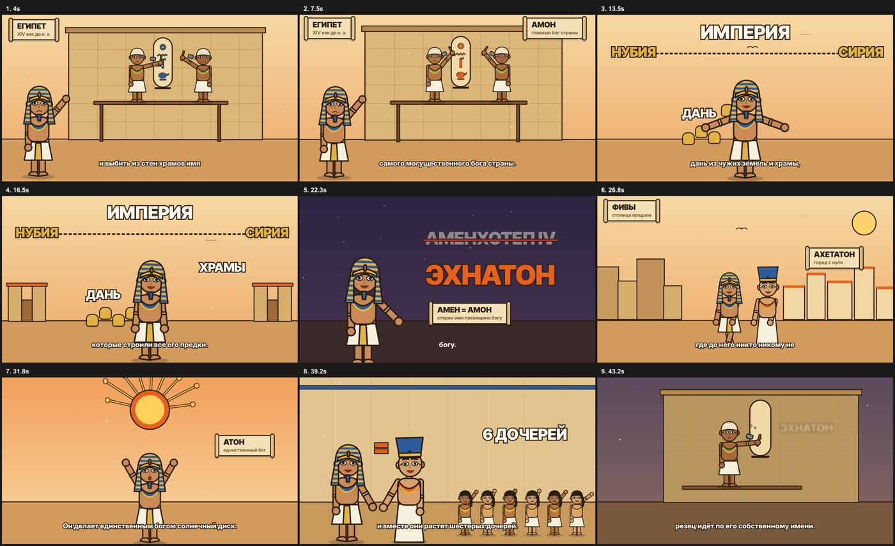
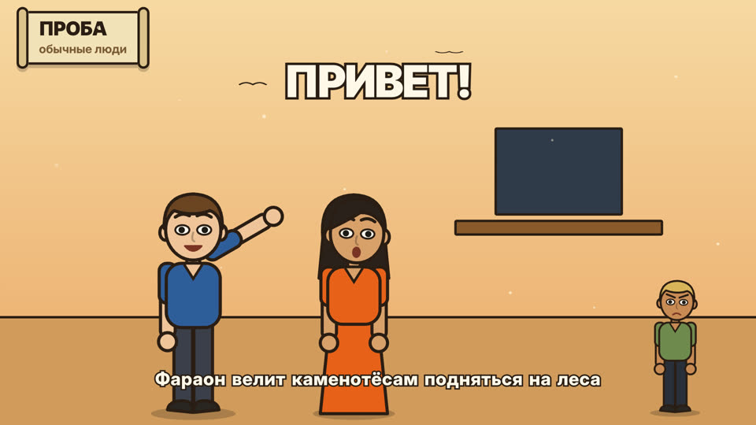

# Мультик из озвучки в Claude Code

Кладёшь в папку файл с голосом, пишешь Claude «сделай мультик по озвучке», и он собирает плоский 2D-мультфильм целиком кодом: персонажи с контуром моргают, дышат, машут руками, меняют эмоции, ходят; крупные слова и подписи выскакивают точно на словах голоса; внизу субтитры, на действиях звуки.

Персонажи: обычные люди (мужчина, женщина, дети), рабочие и египетский набор для истории.

## Что нужно

- [Claude Code](https://claude.com/claude-code) (в терминале или во вкладке Code в приложении Claude)
- Node.js 22+ и ffmpeg. Mac: `brew install node ffmpeg`. Windows: `winget install OpenJS.NodeJS ffmpeg`
- Python 3.9+

Платные сервисы не нужны: расшифровка голоса и рендер идут на твоём компьютере.

## Как запустить

1. Скачай папку: зелёная кнопка **Code → Download ZIP**, распакуй. Или `git clone`.
2. Положи озвучку в папку `in/` (mp3, wav или m4a).
3. Открой эту папку в Claude Code и напиши: **«Сделай мультик по озвучке in/имя-файла»**.
4. Claude покажет раскадровку по сценам, ты согласуешь, потом он соберёт сцены, проверит кадры и отрендерит `projects/<имя>/render.mp4`.

Скилл работает только внутри этой папки: он лежит в `.claude/skills/mult-2d/` и в другие проекты не попадает.

## Что внутри

- `.claude/skills/mult-2d/SKILL.md`: инструкция для Claude, порядок работы и правила стиля
- `.claude/skills/mult-2d/lib/mult.py`: персонажи, подписи, фон, сцены, субтитры
- `.claude/skills/mult-2d/lib/new_project.py`: новый проект из озвучки (копирует шаблон, расшифровывает голос по словам)
- `.claude/skills/mult-2d/examples/ekhnaton.py`: пример на 7 сцен, 45 секунд
- `.claude/skills/mult-2d/template/`: шрифты Inter и Inter Tight (лицензия OFL) и звуки

Рендер на движке [HyperFrames](https://github.com/heygen-com/hyperframes).

## Честно

- Первый запуск дольше: скачивается движок и модель распознавания речи.
- Персонажи стоят лицом к зрителю, профиля и поворотов пока нет.
- Музыку скилл не добавляет, только голос и звуки.
- Минута мультика: 10–20 минут работы Claude и около минуты рендера.
